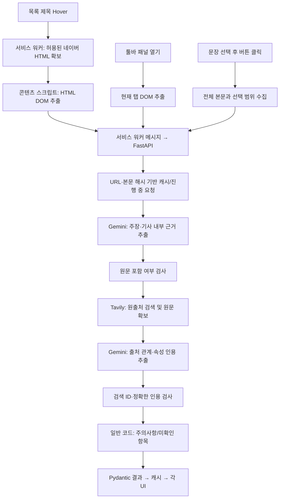

# 시스템 구조와 데이터 흐름
기준: source-tracing-v1, Chrome 확장 manifest 0.2.0. 현재 소스 기준이며 향후 설계와 구분한다.

## 구성
| 구성 | 실제 파일 | 책임 |
|---|---|---|
| 콘텐츠 스크립트 | newscheck 4/content.js | 네이버 Hover/선택, Shadow DOM 팝업 |
| 기사 추출 | newscheck 4/lib/extract.js | selector·meta·문단 기반 DOM 추출; Readability 미도입 |
| 서비스 워커 | newscheck 4/background.js | 메시지 경로 제한, 네이버 HTML fetch, 서버 요청 |
| 패널 | sidepanel/*, shared/view.js | 한 줄 요약·6개 독립 카드·표현 차이 |
| 설정·클라이언트 | options/*, shared/api.js | 서버 주소/권한, 응답 검사; 브라우저 키 사용 안 함 |
| 데이터 계약 | shared/types.ts, backend/app/models.py | TS 입출력 타입 및 Pydantic 검증 |
| API | backend/app/main.py | health/analyze/preview/claims-check, 422/502 |
| AI·검색 | clients.py, prompts.py | Gemini 구조화·Tavily 실제 자료 검색 |
| 출처 분석·캐시 | service.py | 원문/ID 검사, 출처 상태·주의사항, 결과 공유 |

## 흐름

## 호출·권한
- 패널은 툴바의 명시적 동작으로 열린다. 일반 사이트의 수동 패널 추출은 activeTab 권한을 사용하며 지원 보장은 네이버에 한정한다.
- 자동 content script는 news.naver.com 및 n.news.naver.com에만 주입한다.
- Hover fetch는 네이버 HTTPS /article/ 또는 /mnews/article/ 경로, credential 제외, redirect 거부, 12초 timeout이다. HTML 2,000,000자를 넘으면 거부한다.
- 콘텐츠 스크립트는 외부 AI에 직접 접속하지 않는다. 워커가 설정 서버에 POST한다.
- 서버 기본 주소는 http://127.0.0.1:8000. 원격 서버는 HTTPS만 허용하고 설정 저장 시 해당 호스트 권한을 요청한다.
- 서버는 임의 기사 URL을 직접 fetch하지 않는다. 외부 요청은 Gemini SDK와 고정 Tavily endpoint에서만 수행한다.
- 로컬 실행은 단일 프로세스가 기준이며 CORS는 Chrome extension origin을 허용한다. 원격 공개 서버 인증/요청 제한은 미구현이다.

## 공유와 상태
캐시 키는 정규화 URL(추적 query/fragment 제외), 본문 SHA-256, 제목, 메타데이터, 실행 모드,
LLM_MODEL, 스키마 버전, 선택 focus로 구성한다. 같은 키의 진행 중 작업을 공유하고 결과는 깊은 복사로 반환한다.
기본 TTL은 900초, 최대 128건이며 메모리에서만 유지한다. 검색 또는 출처 정리 오류가 있으면 결과를 캐시하지 않는다.
선택이 기존 주장과 겹치면 그 결과를 재사용한다. 새 선택은 전체 본문 문맥과 focus로 별도 키를 만들고 기사 전체 결과를 덮어쓰지 않는다.
클라이언트가 보내는 surrounding_text는 계약에 존재하지만 서버의 권위 있는 문맥은 page_text 전체이며 별도 외부 텍스트를 합치지 않는다.
모드 mock은 요청별 실제 분석 대신 고정 fixture를 반환하므로 article_id/body_hash도 시연용 고정값이다.

## 실패와 제한
- 요청 스키마/본문/선택/분석 ID 오류: 422.
- Gemini·출처 스키마 처리 오류 등 upstream 실패: 내부 원문을 숨긴 502.
- 개별 원출처 검색 실패: partial 결과 + search_status=failed; source_not_found로 바꾸지 않는다.
- 출처 속성 정리 실패/관련 기사 검색 실패는 search_errors에 보존한다.
- 클라이언트 timeout은 120초, Gemini 45초, Tavily 요청별 25초다. 연속 단계 총시간이 클라이언트 timeout보다 길어질 수 있다.
- 자동 backoff/서버 비용 제한/지속 캐시/분산 캐시는 후속 기능이다.
