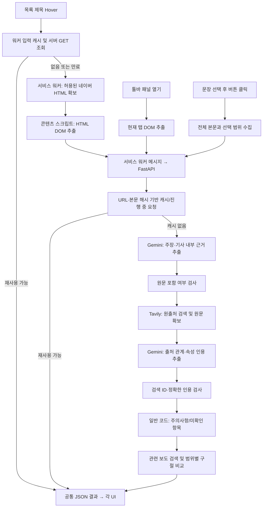

# 시스템 구조와 데이터 흐름
기준: 2026-11-12, source-tracing-v1 / data_version=source-tracing-v1.9, Chrome 확장 manifest 0.2.0. 현재 로컬 소스 기준이며 원격 main의 상태나 향후 설계와 구분한다.

## 처음 코드와 수정본의 구성 차이
최초 업로드 de18984에는 newscheck 4/와 README만 있었다. 별도 Python 서버나 DB가 없고, 확장 프로그램 안에서 화면 처리와 외부 API 요청을 수행했다. background.js라는 이름은 Chrome 서비스 워커를 뜻하며 Python 백엔드 서버를 뜻하지 않는다.

| 영역 | 최초 업로드의 실제 구현 | 현재 로컬 수정본 |
|---|---|---|
| 화면 | sidepanel.js가 분석 상태와 한 페이지 렌더링을 함께 관리 | sidepanel.js는 화면 수명주기, shared/view.js는 6개 카드·팝업 렌더링 |
| 기사 수집 | lib/extract.js의 DOM 선택자·meta·문단 수집 | 기존 추출기 유지, 작성/수정일·JSON-LD·사건·링크·인용·잘림 보완 |
| 분석 | lib/analysis.js의 규칙·가중치 점수, lib/llm.js의 AI 호출 | backend/app/service.py의 추출·출처 추적·주의사항·보도 내용 비교 |
| 외부 API | 브라우저에서 Gemini/OpenAI/Claude 중 설정 공급자 및 네이버 검색 호출 | 서버에서 Gemini·Tavily 호출; 기존 공급자 선택 UI는 유지하지 않음 |
| API 키 | chrome.storage.local에 사용자 키 저장 | backend 환경변수에 저장; 확장은 서버 주소만 저장 |
| 데이터 | 패널 내부 상태와 고정 demo.json | Pydantic·TS·JSON Schema 계약, 입력 기반 Mock와 별도 고정 UI 예시 |
| 캐시 | 현재 탭/분석 상태 재사용 | URL·본문 해시·버전별 서버 캐시와 워커의 단기 입력/HTML 캐시 |
| 검증 | 최초 업로드에는 별도 자동 테스트 폴더 없음 | JS·TS 계약·Python·브라우저·HTTP·Mock 통합 검사 |

## 폴더와 추가 파일의 역할
newscheck 4/ 이름은 기존 경로를 보존하기 위해 유지한다. 이 폴더가 확장 소스이고 저장소 루트가 전체 프로젝트다.

| 폴더·파일 | 기존/추가 | 실제 내용과 책임 |
|---|---|---|
| newscheck 4/manifest.json | 기존 수정 | 확장 권한·서비스 워커·패널·네이버 content script 진입점 |
| newscheck 4/background.js | 기존 수정 | 확장 메시지 검증·기사 HTML 수집·서버 요청·단기 캐시; Python 서버 아님 |
| newscheck 4/content.js | 추가 | 네이버 기사 링크 Hover와 본문 선택, Shadow DOM 팝업 |
| newscheck 4/lib/extract.js | 기존 보완 | 기사 원문/메타데이터 수집 및 원문 위치 이동 |
| newscheck 4/lib/analysis.js, naver.js | 기존 보존·현 경로 미사용 | 과거 분석/네이버 검색 유틸리티. 현재 기능으로 오해하거나 새 서버와 중복 연결하지 않음 |
| newscheck 4/lib/llm.js | 기존 교체 | 직접 AI 호출을 제거하고 shared/api.js를 재노출하는 호환 파일 |
| newscheck 4/shared/article.js | 추가 | 추출 결과를 공통 요청 JSON으로 변환, URL 정규화 |
| newscheck 4/shared/api.js | 추가 | 서버 주소/응답/참조 검사와 HTTP 오류 처리; API 키 없음 |
| newscheck 4/shared/cache.js | 추가 | 워커의 30초/64건 입력 인덱스와 늦은 응답 덮어쓰기 방지 |
| newscheck 4/shared/types.ts | 추가 | 입출력 TypeScript 계약. 모든 JavaScript가 TypeScript로 전환된 것은 아님 |
| newscheck 4/shared/view.js | 추가 | 6개 카드, 독립 토글, Hover/선택 결과, 보도 비교 구절을 안전하게 렌더링 |
| newscheck 4/sidepanel/ | 기존 수정 | HTML 뼈대·CSS·탭/설정 변경에 따른 분석 요청. 첨부 시안의 카드 배치를 반응형으로 적용 |
| newscheck 4/options/ | 기존 수정 | 서버 주소 저장·접속 권한 요청·고정 UI 예시·이전 키 삭제 |
| newscheck 4/data/ | 기존 | demo.json은 가상 UI 예시, press.json은 언론사 도메인/이름 매핑. 두 파일의 목적이 다름 |
| newscheck 4/icons/ | 기존 유지 | 확장 아이콘 |
| backend/app/main.py | 추가 | FastAPI 진입점과 5개 API 경로, CORS·안전한 오류 응답 |
| backend/app/models.py | 추가 | 요청·응답 Pydantic 검증과 enum/참조 규칙 |
| backend/app/service.py | 추가 | 전체 분석 순서·원문/ID 검사·출처 상태·주의사항·캐시·선택 분석 |
| backend/app/clients.py, prompts.py | 추가 | 실제 Gemini/Tavily 호출 어댑터와 단계별 지시문 |
| backend/app/mock.py | 추가 | 네트워크 없는 규칙 기반 Mock 제공자; 기사 입력과 가상 자료를 사용 |
| backend/app/report_comparison.py | 추가 | 다른 보도의 ID·양쪽 인용을 검사하고 공통 항목/표현 차이를 구성 |
| backend/app/errors.py | 추가 | 공급자 오류 코드·HTTP 상태·Retry-After 파싱 |
| backend/app/__init__.py | 추가 | Python app 패키지 표시; 별도 사용자 기능 없음 |
| backend/requirements*.txt, .env.example | 추가 | 의존성 목록/고정 버전과 값이 비어 있는 환경설정 예시 |
| backend/tests/ | 추가 | 출처/주의사항·캐시·조회·공급자 오류·Mock·보도 비교 회귀 |
| fixtures/ | 추가 | 대표 네이버 형태의 가상 HTML과 가상 원자료/다른 보도. 실제 뉴스 데이터 아님 |
| tests/ | 추가 | jsdom UI/추출/API 검사와 TS 계약. Python 테스트와 역할 구분 |
| scripts/ | 추가 | build, schema export, 브라우저·HTTP·통합 smoke, 커밋 제외/비밀 패턴 검사 |
| scripts/check_api_setup.py | 추가 | 기본은 키/모델의 설정 여부만 검사. --list-models는 Gemini 모델 목록 요청, --live는 Gemini·Tavily 각 1회 연결 검사. 키 값과 예외 원문을 출력하지 않음 |
| docs/ | 추가 | PROJECT_SPEC=기능 기준, ARCHITECTURE=구조, API_SPEC/스키마=계약, AI_PIPELINE=처리 과정, UI_SPEC=화면, VALIDATION=증거, MIGRATION=변경, TODO=남은 일 |
| .github/workflows/ci.yml | 추가 | GitHub에서 같은 Mock 검사를 자동 실행. 설정 파일 존재와 원격 실행 성공은 별개 |
| AGENTS.md, CODEX_START_PROMPT.md, CONTRIBUTING.md | 추가 | 개발 규칙·최초 작업 안내·Git/PR 협업 절차. 실행 코드 아님 |

로컬 설치 시 node_modules/와 .venv/는 의존성, dist/newscheck는 빌드 결과, .tools/는 임시 검사 로그·화면이다. backend/.env는 개인 키 설정이다. 이 항목들은 Git 제외 대상이며 프로젝트 소스와 구분한다. 현재 DB 폴더나 React 앱은 없다.

## 원출처와 주의사항을 알아내는 범위
예를 들어 기사에 '가상연구원의 ○○조사에 따르면'이라고 적혀 있으면 Gemini가 기관·자료명·기사 인용을 추출하고, service.py가 이를 검색어로 조합한다. Tavily는 해당 자료의 URL과 확보 가능한 본문을 반환한다. Gemini가 자료의 작성기관·작성자·직접 발표/재인용·시점·방법 등에 관한 실제 구절을 선택하면 서버는 그 구절이 전달된 원문에 있는지 검사한다.
원본 연결에는 기사에 나온 자료명/기관/직접 링크와 자료 자체의 원본 관계·기관 표기가 필요하다. 출처 URL이 유명하거나 검색 순위가 높다는 이유로 원본/신뢰 가능으로 확정하지 않는다. 다만 현재 검사는 '최초 원본'의 완전한 증명이나 자격/이해관계의 독립 조사까지 하지 않는다.
주의사항은 일반 코드가 익명 발언·재인용·원출처 미확인·조사 방법 미확인·오래된 자료·의견/예측 등의 조건에서 이유를 구성한다. 자료 내용의 사실 여부나 논리적 타당성을 판정하지 않는다.

## API를 사용하는 위치와 설정
API는 프로그램끼리 요청과 응답을 주고받는 창구다. 확장은 자체 FastAPI에 JSON을 보내고, live 서버가 다시 Gemini API와 Tavily API를 호출한다. 실제 서버 주소와 API 키는 서로 다른 값이다.
- 서버 주소 http://127.0.0.1:8000은 이 컴퓨터에서 실행한 프로그램의 위치다. 다른 사람의 컴퓨터에서는 그 사람도 서버를 실행하거나 별도로 배포된 HTTPS 서버를 설정해야 한다.
- backend/.env에는 ANALYSIS_MODE, GEMINI_API_KEY, LLM_MODEL, TAVILY_API_KEY를 설정한다. uvicorn의 --env-file 옵션으로 읽고 서버를 재시작한다. 터미널의 ANALYSIS_MODE 환경변수가 있으면 파일보다 우선한다.
- Gemini는 추출·출처 속성 정리·보도 비교, Tavily는 자료/관련 기사 검색·검색 URL 원문 확보를 담당한다. 키를 확장에 배포하지 않고 서버에서 교체/관리하기 위해 분리했다. 로컬 .env도 비밀 파일이며 공개 서버의 인증·사용자별 한도는 별도 미구현이다.
- 서버는 기사 본문·자료 발췌를 Gemini에, 기관/자료명·일부 기사 문구/제목 등의 질의를 Tavily에 보낸다. mock에서는 외부로 보내지 않는다.

## Mock와 고정 예시의 차이
Mock는 실제 외부 서비스를 규칙/가상 자료로 대신해 프로그램 연결을 시험하는 방식이다. 현재 mock.py는 본문 앞 3개 문장(선택 시 선택 문장)을 가져오고 일부 단어/표현으로 유형·기관·자료명·날짜를 단순 추출한다. 알려진 가상 자료명/URL이 검색어와 맞을 때만 fixture 자료를 돌려준다. 새 실제 기사의 원출처를 인터넷에서 찾거나 AI 수준으로 의미를 이해하지 않는다.
이후 원문/ID 검사·주의사항·공유 캐시·UI는 live와 같은 코드를 거친다. 따라서 '입력에 따라 결과가 바뀐다'와 '실제 AI 분석을 했다'를 구분해야 한다. 설정의 시연용 예시 보기는 서버도 사용하지 않는 고정 demo.json 화면이다.

## 구성
| 구성 | 실제 파일 | 책임 |
|---|---|---|
| 콘텐츠 스크립트 | newscheck 4/content.js | 네이버 뉴스·연합뉴스TV Hover/선택, Shadow DOM 팝업 |
| 기사 추출 | newscheck 4/lib/extract.js | selector·meta·문단 기반 DOM 추출; Readability 미도입 |
| 서비스 워커 | newscheck 4/background.js | 메시지 경로 제한, 허용된 네이버 뉴스·연합뉴스TV 기사 HTML fetch, 서버 요청 |
| 패널 | sidepanel/*, shared/view.js | 요약 글머리표 옆 작은 기본 정보·네모/화살표 배경·한 줄 관련 보도·6개 독립 카드·표현 차이 |
| 설정·클라이언트 | options/*, shared/api.js | 서버 주소/권한, 응답 검사; 브라우저 키 사용 안 함 |
| 데이터 계약 | shared/types.ts, backend/app/models.py | TS 입출력 타입 및 Pydantic 검증 |
| API | backend/app/main.py | health/analyze/preview/claims-check/기존 결과 조회, 구조화된 오류 |
| AI·검색 | clients.py, prompts.py | Gemini 구조화·Tavily 실제 자료 검색 |
| 출처 분석·캐시 | service.py | 원문/ID 검사, 출처 상태·주의사항, 결과 공유 |

## 흐름

## 호출·권한
- 패널은 툴바의 명시적 동작으로 열린다. 일반 사이트의 수동 패널 추출은 activeTab 권한을 사용하며 지원 보장은 네이버에 한정한다.
- 자동 content script는 news.naver.com 및 n.news.naver.com에만 주입한다.
- Hover fetch는 네이버 HTTPS /article/ 또는 /mnews/article/ 경로, credential 제외, redirect 거부, 12초 timeout이다. HTML 2,000,000자를 넘으면 거부한다.
- 콘텐츠 스크립트는 외부 AI에 직접 접속하지 않는다. 워커가 설정 서버에 POST한다.
- 서버 기본 주소는 http://127.0.0.1:8000. 원격 서버는 HTTPS만 허용하고 설정 저장 시 해당 호스트 권한을 요청한다.
- 서버는 임의 기사 URL을 직접 fetch하지 않는다. 외부 요청은 Gemini SDK와 고정 Tavily endpoint에서만 수행한다.
- 로컬 실행은 단일 프로세스가 기준이며 CORS는 Chrome extension origin을 허용한다. 원격 공개 서버 인증/요청 제한은 미구현이다.

## 공유와 상태
캐시 키는 정규화 URL(추적 query/fragment 제외), 본문 SHA-256, 제목, 메타데이터, 실행 모드,
LLM_MODEL, 스키마 버전, 선택 focus로 구성한다. 같은 키의 진행 중 작업을 공유하고 결과는 깊은 복사로 반환한다.
기본 TTL은 900초, 최대 128건이며 메모리에서만 유지한다. 검색 상태가 failed이거나 search_errors가 있으면 결과를 캐시하지 않는다. 원출처 검색이 필요하지 않아 not_run인 정상 결과도 재사용한다. 이는 출처가 확인됐다는 뜻은 아니다.
선택이 기존 주장과 겹치면 그 결과를 재사용한다. 새 선택은 전체 본문 문맥과 focus로 별도 키를 만들고 기사 전체 결과를 덮어쓰지 않는다.
클라이언트가 보내는 surrounding_text는 계약에 존재하지만 서버의 권위 있는 문맥은 page_text 전체이며 별도 외부 텍스트를 합치지 않는다.
모드 mock도 동일 Analyzer에서 입력 기사·본문 해시를 사용하되 공급자만 MockLLM/MockSearch로 바꾼다. 정적 UI ?demo의 고정 fixture는 별도이다.
워커 ArticleInputCache는 정규화 URL별 입력·analysis ID를 30초/최대 64건 기억하고 GET 기존 결과 조회 및 본문 SHA-256 검사를 통과한 경우에만 Hover에 재사용한다. 차가운 Hover의 HTML도 30초/64건·동시 fetch 중복 방지를 적용한다.
서버 cache key는 ArticleContext·정규화 메타 URL·data_version=source-tracing-v1.8도 포함한다.

## 실패와 제한
- 요청 스키마/본문/선택/분석 ID 오류: 422.
- 전체 공급자 실패: 설정 누락 503, 요청 제한 429, 시간 초과 504, 그 밖의 응답/연결 오류 502. code/provider/retry_after_seconds를 제공하고 내부 원문은 숨긴다.
- 개별 원출처 검색 실패: partial 결과 + search_status=failed; source_not_found로 바꾸지 않는다.
- 출처 속성 정리 실패/관련 기사 검색 실패는 search_errors에 보존한다.
- 클라이언트 timeout은 120초, Gemini 45초, Tavily 요청별 25초다. Gemini SDK의 retry attempts를 1로 명시해 내부 자동 재시도를 제한한다. 연속 단계 총시간이 클라이언트 timeout보다 길어질 수 있다.
- 자동 backoff/서버 비용 제한/지속 캐시/분산 캐시는 후속 기능이다.

## 추가 연결 경로
관련 보도 최대 3건은 같은 검색 결과의 본문 발췌/검색 요약/제목 범위를 명시하고 Gemini의 추가 구조화 호출로 비교한다. report_comparison.py에서 서버 ID 및 양쪽 원문 인용을 검사한 항목만 저장한다. 결과는 related_articles의 comparison_points에 포함되며 6번째 카드 안에서만 요약/상세 비교를 제공한다. 실패는 related_comparison 단계 오류로 남기고 출처 상태·주의사항을 진위 판정으로 바꾸지 않는다.
검색 결과의 원문 누락은 고정 Tavily extract endpoint로만 보강하며 URL 후보 허용 목록을 적용한다. 기사 내부 링크는 원본 관계가 아닌 기사 인용 연결의 근거로만 사용한다.
섹션별 상태와 pipeline_errors, 이유별 주의사항 참조, 사건/타임라인 출처가 같은 ArticleAnalysis에 포함된다.
scripts/integration-smoke.mjs는 실제 worker와 HTTP 서버를 연결하되 Chrome API·네이버 페이지를 어댑터로 대체한다. 실제 설치 검사는 여전히 별도다.

## 제목에서 근거까지의 연결
Extraction.headline_explanation → clean_extraction의 기사 인용·ID 검사 → source/mention 연결 → ArticleAnalysis → shared/view.js의 제목 카드가 같은 결과를 공유한다. 더보기의 이유 버튼은 이미 받은 데이터로 근거 카드를 펼쳐 스크롤·포커스를 이동한다. 이동 시 외부 API를 다시 부르지 않는다. 자료 연결이 없으면 trace-overview로 이동한다.
타임라인의 label은 표시용 짧은 표현이고 description/article_quote는 원문이다. is_main_event는 주요 사건 표시용이며 사실 여부나 공신력 점수가 아니다. 기존 6개 카드·팝업·분석 API는 유지한다.

## Hover와 상세 분석의 단계 공유
Analyzer._extract는 본문 이해 결과와 진행 중인 추출을 키별로 공유한다. Preview는 이 단계에서 반환하고 Tavily·DART·출처 검토를 호출하지 않는다. 전체 analyze는 같은 추출의 깊은 복사로 후속 검증을 진행한다. 완성된 분석은 기존 cache에만 저장하며 추출만 있는 ID의 GET 전체 결과 조회는 404다. 추출 임시 캐시는 TTL/128건 제한, refresh 우회, 전체 분석 종료 시 정리를 적용해 실패한 전체 분석의 재시도를 막지 않는다.

## 점수 없는 출처 확인·주의 상태 (2026-11-14)
서버의 출처 조사·주의사항 데이터를 클라이언트 sourceNotice()가 표시용 상태로 정리한다. 전체 기사와 자동 배지는 같은 규칙을 쓴다. 가중 점수/백분율/매체 평판 모델을 만들지 않으며 신규 네트워크 요청은 없다. traceSummary()의 주의 건수도 중복 제거한 같은 주의 목록을 센다. API 경로·data_version·캐시·Gemini/Tavily 호출 순서는 유지한다.

## 일반 페이지 선택·단어 경로 (2026-11-14)
일반 HTTP(S) 콘텐츠 스크립트 → shared/selection.js(단어 구분·실제 DOM 문맥) → NEWSCHECK_SELECTION 또는 NEWSCHECK_WORD → worker → FastAPI. 본문 밖 선택은 발췌 scope를 표시하고 기존 전체 기사 인덱스를 갱신하지 않는다. Hover 외부 페이지 수집 허용 목록은 그대로 유지한다.
단어는 words.WordExplainer에서 사전 도메인 제한 Tavily 검색 → Gemini WordDraft → 검색 ID·인용/문맥 검증 → WordAnalysis로 반환한다. 별도 TTL/진행 요청 캐시를 사용하고 기사 전체 분석을 호출하지 않는다. mock 모드는 외부 네트워크를 호출하지 않는다.

## 보도 재확인 경고 (2026-11-14)
ComparisonCandidatePoint(LLM) → apply_comparisons(실제 자료/참조 대조) → ReportComparisonPoint(review_status 서버 부여) → sourceNotice → 패널·배지·주의 카드와 관련 기사 대조 이동이다. 현재 기사 인용 링크와 확인된 article_cited 원자료 URL을 인용 관계 확인에 사용한다. 캐시 버전은 source-tracing-v1.8이며 새 네트워크 단계는 추가하지 않는다.

## 원격 main의 외신 기능 통합 (2026-11-14)
기준 원격 main은 cd1794e(PR #8 외국기사 번역, PR #9 외신 검색/원문 대조/관련 기사 필터/작성일 추출)다. 내 기능의 보관 커밋은 bedc691이며 feat/source-caution-update에서 병합한다.
외신/기관 도메인 검색, 영어 검색어·후속 보도 검색, 관련 기사 필터·정렬과 작성일 추출을 보존했다. 주장/근거의 한국어 번역과 비교 구절의 번역/차이 설명은 원문과 분리한다.
사용자 선택에 따라 상단 ‘원문과 다른 점’ 카드를 유지하고 빨간 재확인 안내와 관련 기사 이동을 연결한다. 기존 6개 카드의 독립 토글·고정 선택·단어 API는 유지한다.
공식 매체 도메인과 추정 번역의 단어 유사성은 원문 후보 선정에만 사용한다. 실제 인용 관계/원본 확인으로 자동 승격하지 않는다. 원문 후보는 상단 카드에서 ‘인용 관계 미확인’으로 구분하고 두 인용·AI 번역·차이 설명을 제공한다. 직접 링크 등 실제 연결 근거와 원자료 관찰이 확인될 때만 기존 출처 확인 로직을 적용한다.
신뢰 지수·가중치(귀속 차이 3배 포함)는 사용하지 않는다. 서술 충돌의 빨강/요약 수준의 노랑은 기존 재확인 조건을 따른다. 원문 후보라는 이유만으로 빨강이 되거나 실제 인용 원본이 되지 않는다.
두 브랜치가 각각 1.8을 사용했으므로 통합 후 data_version/health/캐시는 source-tracing-v1.9다. 서버 재시작 → npm run build → 확장 새로고침 → 기사 F5 → 다시 분석으로 적용한다.
