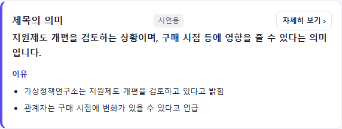
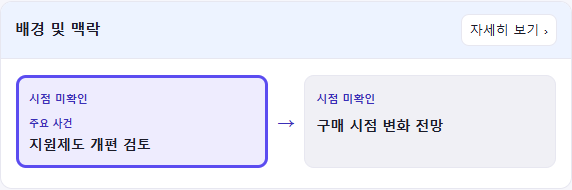
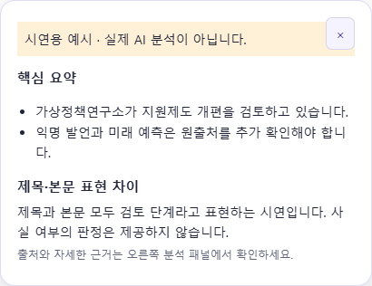
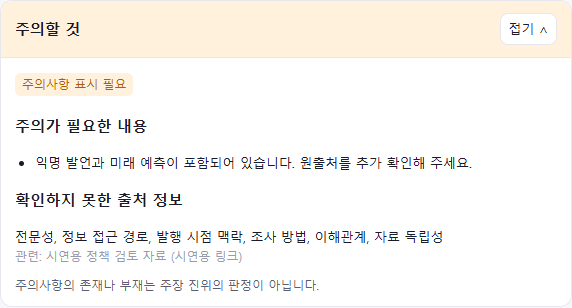

# 제목 설명·Hover·주의사항 변경 화면

모든 이미지는 현재 확장 UI를 로컬 Chrome headless에서 렌더링한 **고정 시연 데이터** 캡처다. 실제 기사·출처 또는 Gemini/Tavily 분석 품질을 검증한 자료가 아니다. API 키·개인 브라우저 프로필은 사용하지 않았다.

| 화면 | 변경 이유와 동작 |
| --- | --- |
| 제목 의미·이유 | 제목을 빠르게 이해하도록 의미 1~2문장과 간결한 이유 글머리표를 분리했다. 자세히 보기에서 원문 인용과 기존 근거 카드 이동을 제공한다. |
| 배경 타임라인 | 긴 설명을 짧은 표현의 박스와 화살표로 바꾸고 주요 사건을 굵게 표시한다. 날짜는 설명과 분리하며 확인되지 않은 날짜를 만들지 않는다. |
| Hover 미리보기 | 중복된 주장·근거 상세를 제거하고 요약과 제목 표현 차이만 보여준다. 대기 250ms, 미리보기는 외부 출처 검색을 기다리지 않는다. 실제 모델 응답 시간 단축을 측정한 것은 아니다. |
| 주의사항 상세 | 같은 이유/출처 참조를 합치고 미확인 항목은 한 번만 모았다. 빈 구역과 반복 안내를 제거했다. |

## 제목 의미·이유

## 짧은 배경·주요 사건 강조

## 간결한 Hover

## 중복을 줄인 주의사항 상세

화면 동작은 [UI 명세](../UI_SPEC.md), 검증 범위는 [검증 결과](../VALIDATION.md)를 따른다. 상세 펼침 시 추가 분석은 아직 구현하지 않았으며 [남은 과제](../TODO.md)에 검토 방안으로 남겼다.
